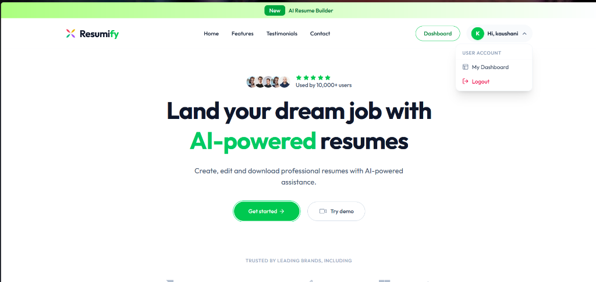
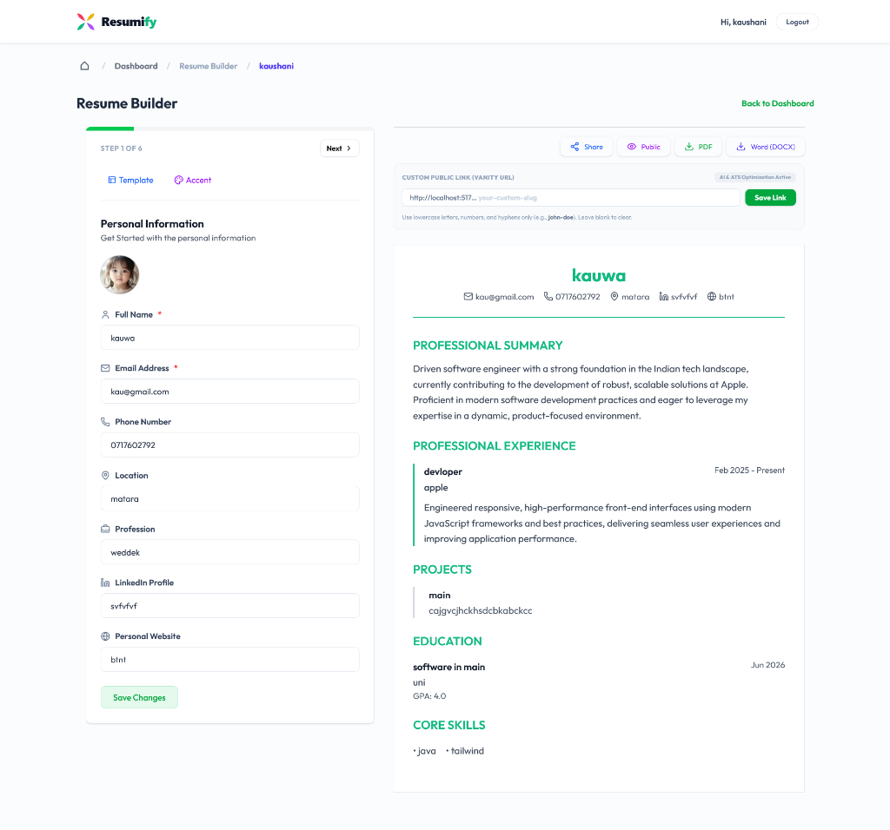

# Resumify - AI-Powered Resume Builder & ATS Optimizer

Resumify is a premium, full-stack resume builder and Applicant Tracking System (ATS) optimization platform. Built with modern web aesthetics, it enables users to design high-converting resumes, parse existing CVs using AI, audit resume compatibility against ATS filters, and share vanity public links.

---

## 🖥️ Platform Screenshots

### Landing Page


### Interactive Resume Builder Workspace


---

## 🌟 Key Features

### 💻 Frontend Workspace (React & Vite)
- **Interactive Dashboard**: Dynamically styled resume cards featuring hover controls (ATS scan, Edit, Delete), search filtering, and list sorting (Newest, Oldest, Highest ATS Score).
- **Split-Screen Builder**: Real-time side-by-side editing pane alongside a live rendering preview of the resume document.
- **Visual Design System**: Select from premium templates (Classic, Modern, Developer, Creative, Academic) and customize accent colors instantly.
- **Responsive Navigation**: Adapts to mobile and tablet screen boundaries with a dedicated tab switcher ("Edit Form" vs "Preview Resume") for smaller screens.
- **Onboarding Guides**: Responsive step-by-step onboarding tours highlighting dashboard tools and builder workspace options.
- **Public & Private Toggles**: Controls resume visibility, exposing custom public URLs (Vanity URLs) with secure copy-to-clipboard actions.

### ⚙️ Backend Services (Node.js & Express)
- **Secure Authentication**: User sign-up and sign-in pipelines powered by `bcrypt` password hashing and signed JSON Web Tokens (JWT).
- **AI ATS Auditing**: Scans resume text using the `openrouter/owl-alpha` reasoning model to compute compatibility scores and list structural weaknesses.
- **Cloudinary Image Processing**: Uploads profile pictures with face-focused thumbnail cropping and optional background removal.
- **Nodemailer Notification Engine**: Dispatches welcome emails upon sign-up, payment alerts on plan upgrades, and preview link updates when a CV is finished.
- **Stripe Subscription Engine**: Integrates Stripe checkout sessions and secure webhook callbacks to manage billing status upgrades.

---

## 🛠️ Technology Stack

- **Frontend**:
  - React (v19)
  - Vite
  - Tailwind CSS
  - Lucide Icons
  - React Router DOM
  - React Hot Toast
  - PDF.js (CDN-loaded text scraper)

- **Backend**:
  - Node.js
  - Express
  - MongoDB (Mongoose ODM)
  - JSON Web Tokens (JWT)
  - Bcrypt (Password security)
  - Multer (Multipart uploads)
  - Cloudinary SDK
  - Stripe SDK
  - OpenRouter SDK / OpenAI SDK
  - Nodemailer (SMTP service)

---

## 📂 Project Structure

```text
├── client/                     # Frontend Vite + React application
│   ├── src/
│   │   ├── assets/             # Branding and static data assets
│   │   ├── componets/          # Form inputs, templates, and resume previews
│   │   ├── context/            # React Context API (appContext.jsx)
│   │   ├── Pages/              # Layout, Dashboard, Login, Builder, Preview
│   │   ├── main.jsx            # Entry point wrapping App in Context Provider
│   │   └── App.jsx             # React Router structure
│   └── .env                    # Frontend environment variables
│
└── server/                     # Backend Express REST API
    ├── config/                 # db.js, multer.js, cloudinary.js, AI.js, email.js
    ├── controllers/            # userController.js, resumeController.js, aicontroller.js, paymentController.js
    ├── middleware/             # authMiddleware.js
    ├── models/                 # User.js, Resume.js
    ├── routes/                 # userRoutes.js, resumeRoutes.js, aIRoutes.js, paymentRoutes.js
    ├── server.js               # Express application entry point
    └── .env                    # Server environment variables
```

---

## 🚀 Getting Started

### Prerequisites
- Node.js (v18 or higher)
- MongoDB Atlas cluster
- Cloudinary credentials
- OpenRouter API credentials
- Stripe developer keys
- SMTP credentials (e.g. Gmail App Password)

### Installation & Execution

1. **Clone the Repository**
   ```bash
   git clone https://github.com/melan-Akash/Resume-Builder.git
   cd Resume-Builder
   ```

2. **Backend Setup**
   Configure the `.env` file in the `server/` directory with your database connection, API keys, credentials, and ports. Then run:
   ```bash
   cd server
   npm install
   npm start
   ```

3. **Frontend Setup**
   Configure the `.env` file in the `client/` directory with your API base URL. Then run:
   ```bash
   cd ../client
   npm install
   npm run dev
   ```

## Local resume analysis (no LLM API)

The resume helper endpoints now run locally in the Node.js backend. The UI, endpoint paths, and JSON response fields have been kept unchanged.

- **Summary and job-description enhancement:** lightweight text rules and templates; these do not call an external generative model.
- **Resume import:** pattern/section-based extraction from plain text. It works best when the uploaded text has clear headings such as Summary, Skills, Education, Experience, and Projects. It is not a full PDF/DOCX parser.
- **ATS report:** a small logistic-regression classifier is trained in memory at server startup using a small, hand-labelled seed set, then combined with transparent resume-quality checks. This is a learning/demo model, not a production-grade ATS or a large language model.

No `OPENAI_API_KEY`, `GEMINI_API_KEY`, or `OPENROUTER_API_KEY` is required for these resume features. Existing MongoDB, authentication, Cloudinary, and payment configuration may still be required for the rest of the app.

### Improving the model honestly

For a stronger model, collect a representative set of resumes with human-reviewed labels and job descriptions, split it into train/validation/test sets, evaluate precision/recall and calibration, and train on that data. Do not describe the current small seed model as a broadly accurate or production-ready AI model.
